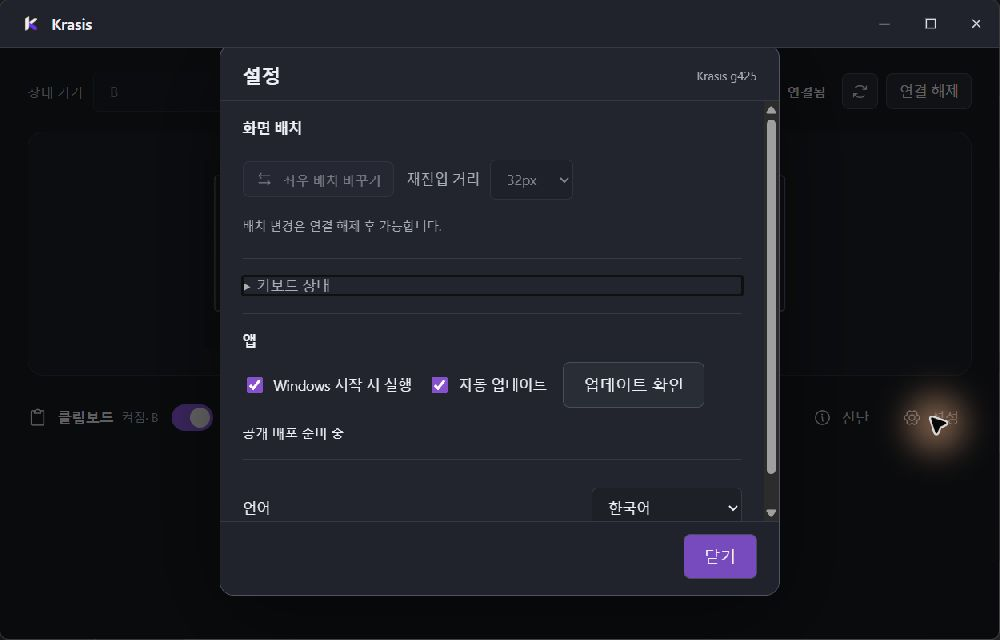

# Issue 15: observed settings keyboard focus

The installed g425 native window was inspected through Windows Computer Use.
After foreground activation, its screenshot showed the connected workspace
without the earlier firewall prompt. The first occluded capture showed another
application and is explicitly excluded from visual acceptance.

The accessibility tree exposes the peer selector, named icon buttons, connection
status, clipboard switch, settings dialog/title and labeled controls. This is
an observed UI Automation tree, not a screen-reader compatibility claim.
Opening Settings, pressing Tab and then Shift+Tab produced visible focus on
the startup checkbox and Keyboard state disclosure respectively. UI Automation
reported the native parent window as focused even when screenshot focus moved;
therefore its focused_element alone is not accepted as control-focus evidence.

The disclosure used a nearly black browser-default outline against the dark
panel. The shared accent focus rule covered buttons, selects, links and inputs,
but omitted native summary controls. g426 adds summary:focus-visible to that
existing rule, covering both Keyboard state and update detail disclosures.
No focus order, setting, input processing or security behavior is changed.

Observed before screenshot:

Validation before packaging: all 85 existing frontend tests pass; native Vite
build passes; git diff --check passes. This low-impact CSS correction adds no
implementation-mirroring test. Native packaged screenshot validation follows.

Issue #15 remains open: this single live connected/settings review does not
prove every state, locale, DPI or screen-reader combination. Publication and
exact-revision hosted CI are also required and remain forbidden by the current
no-push instruction. No criterion is removed to enable closure. No API, DB,
dependency, runner, certificate, firewall or repository-hygiene change.
