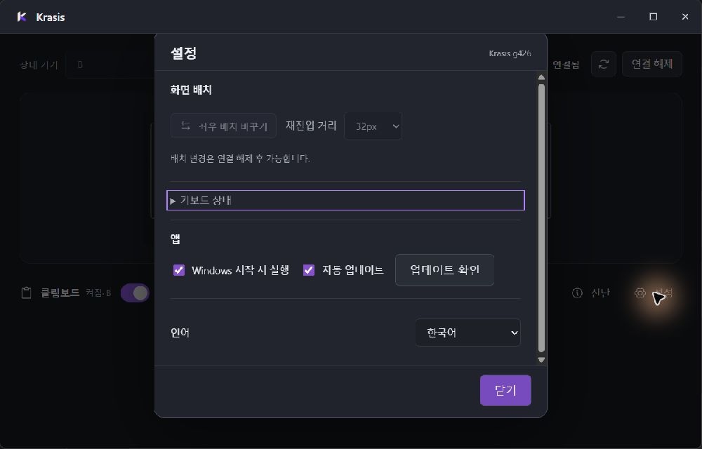
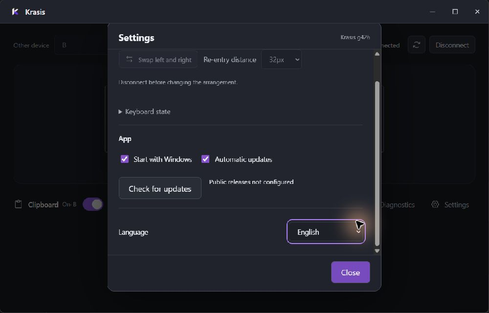

# Issue 15: observed settings keyboard focus

The installed g425 native window was inspected through Windows Computer Use.
After foreground activation, its screenshot showed the connected workspace
without the earlier firewall prompt. The first occluded capture showed another
application and is explicitly excluded from visual acceptance.

The accessibility tree exposes the peer selector, named icon buttons, connection
status, clipboard switch, settings dialog/title and labeled controls. This is
an observed UI Automation tree, not a screen-reader compatibility claim.
Opening Settings, pressing Tab and then Shift+Tab produced visible focus on
the startup checkbox and Keyboard state disclosure respectively. UI Automation
reported the native parent window as focused even when screenshot focus moved;
therefore its focused_element alone is not accepted as control-focus evidence.

The disclosure used a nearly black browser-default outline against the dark
panel. The shared accent focus rule covered buttons, selects, links and inputs,
but omitted native summary controls. g426 adds summary:focus-visible to that
existing rule, covering both Keyboard state and update detail disclosures.
No focus order, setting, input processing or security behavior is changed.

Observed before screenshot:

Validation before packaging: all 85 existing frontend tests pass; native Vite
build passes; git diff --check passes. This low-impact CSS correction adds no
implementation-mirroring test. Native packaged screenshot validation follows.

## Packaged validation and paired rollout

Source commit 1eaf84b9c2df942a2418f63cb786821a33a4a326 was packaged as g426.
The workspace builder passes 85 UI tests, native frontend and executable/
installer builds, real archive smoke (8.22s) and eight-file verification.

The actual g426 settings window was inspected again after installation.
Tab then Shift+Tab produces the intended accent outline around Keyboard state:

The live Language selector changes Korean to English. The English settings
labels and accessible names are translated, and the lower language control is
reachable by scrolling inside the dialog. The native dropdown's separate
WebView popup rejects a parent-window coordinate click; keyboard Down/Return
selects English. Up restores Korean. Escape dismisses Settings and visibly
restores the accent focus outline to the workspace Settings button. The UI is
left open, in Korean, on the connected workspace. These are limited live
keyboard/localization checks, not a complete locale/DPI/screen-reader matrix.

B update 5a022fc57bec869268f6d622b5ec3b52 reaches UPDATED at g426; its
installation receipt is result 0 at 11:59:43.5928985Z. A's rollout has unresolved
installer outcomes and must not be labeled an installation success:

- The first shell attempt read an unavailable Process.ExitCode as failure and
  reopened g425. That shell outcome did not prove a failed or successful g426
  install; subsequent installed-file hashing still matched g425. Later attempts
  explicitly retain the process, WaitForExit and Refresh before reading its code.
- At 12:01:18.1315874Z the installer returns 5, finish/commit/file_delete,
  Win32 5, recovery required. Installed file hashing now matches g426.
- A follow-up after stopping the path-verified UI and requesting safe-stop
  returns 4 at 12:01:53.878992Z, replace/replace/directory_retire_move,
  Win32 5, recovery restored. No further repair is attempted in this round.
- Subsequent doctor reports matched g426 UI/resident/installed revisions,
  service RUNNING, connection CONNECTED and completed update-stage cleanup.
  This current health does not erase either installer failure receipt.

Paired collection bb73603eda5bb9269c25eafa98696d4b at 12:02:59Z/12:03:00Z
confirms both inputHealth READY and service READY. B's recovery receipt still
reflects the earlier reconnect window; live peer inspection reports ONLINE at
g426, and A's doctor plus actual workspace show CONNECTED. No physical movement
latency claim follows from these observations.

Next priority for #16: reproduce and locate the protected-install retirement/
cleanup access denial, account for old owner exit and preserve recovery
receipts. Do not repeatedly replace healthy installed files to manufacture a
success receipt. Full installer acceptance, signing, hosted CI, physical input
matrices, actual endpoint address change and additional display/DPI checks
remain outstanding. No new implementation begins after the round's ten-minute
cutoff. There is no push, issue comment or issue closure in this round.

Issue #15 remains open: this single live connected/settings review does not
prove every state, locale, DPI or screen-reader combination. Publication and
exact-revision hosted CI are also required and remain forbidden by the current
no-push instruction. No criterion is removed to enable closure. No API, DB,
dependency, runner, certificate, firewall or repository-hygiene change.
